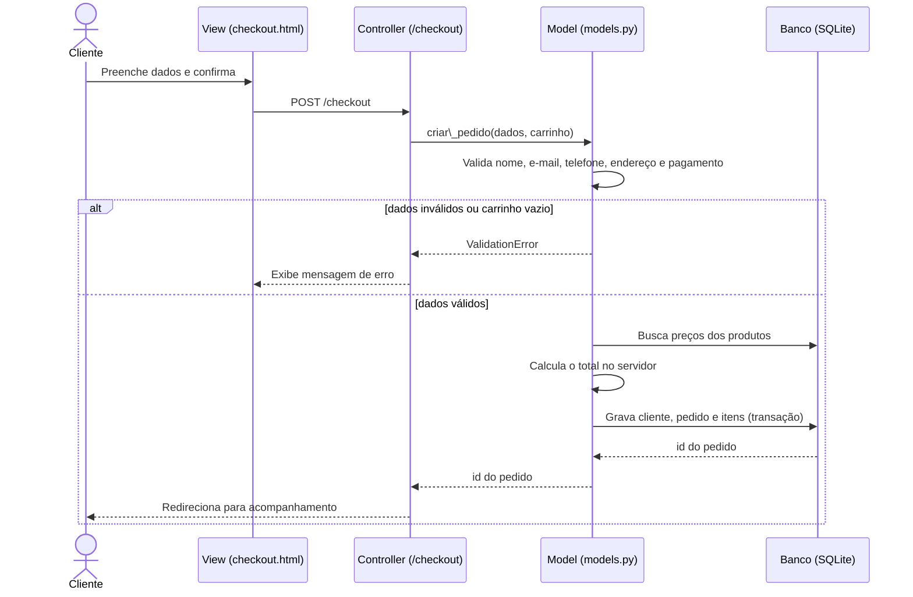
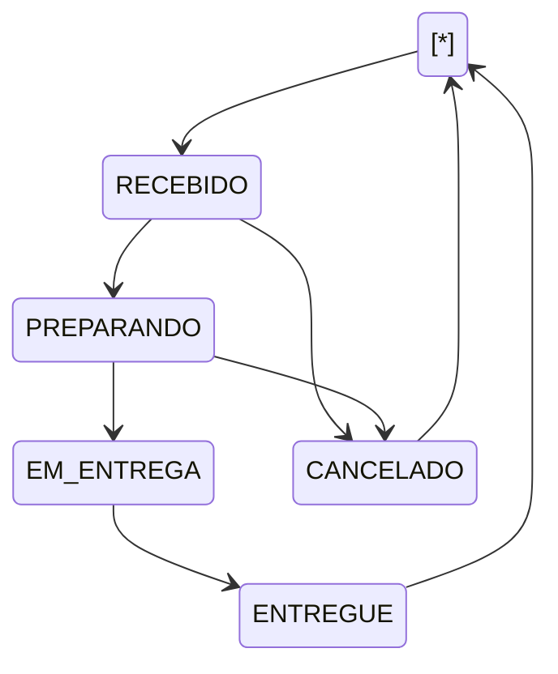

Diagramas – App Loja de Cupcakes Gourmet
Diagramas revisados para refletir o que o aplicativo realmente faz na versão do PIT II.
1. Diagrama de casos de uso
```mermaid
flowchart LR
  C(\[Cliente])
  L(\[Lojista])
  subgraph Sistema\["Loja de Cupcakes"]
    UC1(Consultar catálogo)
    UC2(Gerenciar carrinho)
    UC3(Finalizar pedido)
    UC4(Acompanhar pedido)
    UC5(Autenticar na área da loja)
    UC6(Listar pedidos)
    UC7(Atualizar status do pedido)
  end
  C --- UC1
  C --- UC2
  C --- UC3
  C --- UC4
  L --- UC5
  L --- UC6
  L --- UC7
  UC3 -. inclui .-> UC2
  UC6 -. inclui .-> UC5
  UC7 -. inclui .-> UC5
```
2. Diagrama de classes
```mermaid
classDiagram
  class Cliente {
    +id\_cliente: int
    +nome: string
    +email: string
    +telefone: string
    +criado\_em: datetime
  }
  class Produto {
    +id\_produto: int
    +nome: string
    +descricao: string
    +preco: decimal
    +ativo: bool
  }
  class Pedido {
    +id\_pedido: int
    +endereco\_entrega: string
    +forma\_pagamento: string
    +status: string
    +total: decimal
    +criado\_em: datetime
  }
  class ItemPedido {
    +quantidade: int
    +preco\_unitario: decimal
  }
  Cliente "1" --> "0..\*" Pedido : realiza
  Pedido "1" \*-- "1..\*" ItemPedido : contém
  Produto "1" --> "0..\*" ItemPedido : é vendido em
```
3. Diagrama de sequência – Finalizar pedido

4. Diagrama de atividades – Fluxo de compra
```mermaid
flowchart TD
  A(\[Início]) --> B\[Consultar catálogo]
  B --> C\[Adicionar cupcake ao carrinho]
  C --> D{Adicionar mais itens?}
  D -- Sim --> C
  D -- Não --> E\[Revisar carrinho]
  E --> F\[Finalizar pedido]
  F --> G\[Informar dados, endereço e pagamento]
  G --> H{Dados válidos?}
  H -- Não --> I\[Exibir mensagem de erro]
  I --> G
  H -- Sim --> J\[Registrar pedido com status RECEBIDO]
  J --> K\[Lojista atualiza o status]
  K --> L\[Cliente acompanha o pedido]
  L --> M(\[Fim])
```
5. Diagrama de estados – Status do pedido

6. Diagrama entidade-relacionamento (modelo lógico/físico)
```mermaid
erDiagram
  CLIENTE ||--o{ PEDIDO : realiza
  PEDIDO ||--|{ ITEM\_PEDIDO : contem
  PRODUTO ||--o{ ITEM\_PEDIDO : "e vendido em"
  CLIENTE {
    int id\_cliente PK
    string nome
    string email UK
    string telefone
    datetime criado\_em
  }
  PRODUTO {
    int id\_produto PK
    string nome
    string descricao
    decimal preco
    int ativo
  }
  PEDIDO {
    int id\_pedido PK
    int id\_cliente FK
    string endereco\_entrega
    string forma\_pagamento
    string status
    decimal total
    datetime criado\_em
  }
  ITEM\_PEDIDO {
    int id\_pedido PK
    int id\_produto PK
    in
